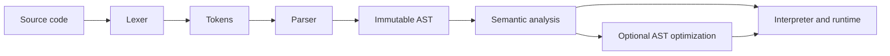

# Project D

A compiler for a dynamically typed language, written in Java 11.

The compiler reads source files, builds an immutable AST, checks names and control-flow
contexts, and executes the original or optimized AST with a tree-walking interpreter.

## Implemented Pipeline



- **Lexer:** tokenization and lexical diagnostics.
- **Parser and AST:** recursive descent parsing, immutable nodes, and tree printing.
- **Semantic analysis:** declaration before usage, lexical scopes, duplicate declarations,
  and validation of `return` and `exit` contexts, including nested functions and loops.
- **AST optimization:** conservative constant folding, constant branch simplification
  with scope preservation, and unreachable code elimination.
- **Interpreter:** dynamically typed values, mutable collections with one-based indexing,
  control flow, lexical closures, and first-class functions.

## Run a Project D program

Build with `mvn clean verify`. Run from the repository root using JDK 11 or newer.

```sh
java -cp target/classes io.github.alextoday111.projectd.interpreter.InterpreterMain examples/valid/03_bubble_sort.d
java -cp target/classes io.github.alextoday111.projectd.interpreter.InterpreterMain --optimize examples/valid/04_higher_order.d
```

The interpreter CLI writes program output to stdout and diagnostics to stderr. Exit codes
are 0 for success, 2 for usage, 3 for file I/O, 4 for lexical errors, 5 for syntax errors,
6 for semantic errors, and 7 for runtime errors.

## Runtime conventions

- Array keys are positive integers. A missing key or tuple field raises a runtime error.
  Tuple writes update existing fields through either their name or position. Concatenation
  appends tuple slots in order and rejects duplicate names in literals or results.
  Array concatenation shifts the right keys by the largest left key and preserves gaps.
  Both concatenations copy the outer slots and share any nested values.
- Ranges include both endpoints and are empty when the start exceeds the end. Collection
  loops snapshot the values at entry and visit array keys in ascending order or tuple
  fields in declaration order. Each iteration has its own bindings.
- Conditions require booleans. Operands and arguments evaluate left to right. `and` and
  `or` short-circuit, while `xor` evaluates both operands. Numeric values support ordering
  and equality. Strings and booleans support equality within their own types.
  String addition converts the other operand to text, with `none` rejected.
  Integer overflow and non-finite real results are runtime errors.
- A declaration is visible as `none` during its initializer. Functions capture the bindings
  visible at creation, including their own declaration for recursion. Calls require exact
  arity. A bare return or the end of a statement body yields `none`. The current source
  grammar requires at least one argument in a call.
- Assignment resolves the target before evaluating the right-hand side. A call result can
  supply the collection for an indexed or field assignment. `print` joins values with
  spaces and ends the line. Aggregate output shows sparse keys and elides cycles.

## Build and Demonstrate

Requires JDK 11+ and Maven. Run from the repository root:

```sh
mvn clean verify
```

The test suite covers the lexer, parser, AST, semantic checks, optimizations, and CLI behavior.

For a presentation in PowerShell:

```powershell
powershell -File scripts/semantic-demo.ps1 -Pause
powershell -File scripts/calculator-demo.ps1 -Pause
```

The first demonstration shows a simple program, semantic errors, and AST transformations.
The second shows a calculator with four arithmetic operations and constant folding.
Both display source examples and original/optimized trees. Use Enter to advance,
or omit `-Pause` for an unattended run. See [examples](examples/README.md) for details.
